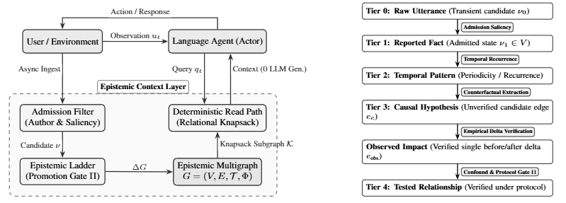

# Beyond Ephemeral Memory: Epistemic Context Layer Artifacts

Artifacts and benchmark outputs for:

> **Beyond Ephemeral Memory: Non-Monotonic Epistemic Context Layers for Long-Horizon Language Agents**  
> Harun Yahya Gokay (2026)



## Overview

Most agent memory setups store history in a vector index or an append-only log, leaving contradictions, superseded facts, and causal claims for the reader model to sort out at inference time. Across long-horizon interactions (role changes, cancelled/restarted projects, budget cuts invalidating prior decisions, retracted claims, and explicit deletions), append-only retrieval accumulates stale context and distractors.

This repo contains the paper PDF, PostgreSQL 16 schema and Row-Level Security (RLS) DDL, three 2,000-turn world-model corpora with derived multigraphs and erasure receipts, EpiBench v2.2 JSON scorecards, and offline verification tests. Core engine code (transition automaton, causal promotion gate, knapsack compiler, write-admission pipeline, production prompts, weights, and UI/auth layers) is kept private.

## Repository Layout

```text
kora-epistemic-artifacts/
├── assets/
│   └── architecture.png                   # System architecture and epistemic promotion ladder
├── paper/
│   └── beyond_memory_kora.pdf             # Paper PDF
├── schema/
│   └── postgres_epistemic_schema.sql      # PostgreSQL 16 DDL, CHECK constraints, and RLS policies
├── world_models/
│   ├── README.md                          # Notes on the 3 world-model corpora
│   ├── world_models_summary.json          # Aggregate corpus stats and write-path spend
│   ├── 01_helixnova_biotech/              # 2,000 turns (9 months): role shifts, cancel/restart, budget alert, NDA erasure
│   ├── 02_vektorflow_saas/                # 2,000 turns (6 months): 3-hop Stripe SLA cascade, pricing reversals, incident erasure
│   └── 03_executive_ops/                  # 2,000 turns (12 months): 0-overlap constraints (allergy, meniscus, freeze), medical erasure
├── benchmark_runs/
│   ├── epibench_v2_2_stress_108.json      # 108-scenario (240-distractor) reader-free substrate scorecard
│   ├── epibench_v2_2_live_depth.json      # Live EpiBench v2.2 depth stress (Depths 6, 24, 60) scorecard
│   └── statistics.py                      # Exact paired McNemar, Odds Ratio, and 95% Wilson CI helpers
├── tests/
│   └── test_paper_claims.py               # Offline schema, corpus, scorecard, and stats checks
├── requirements.txt
└── LICENSE                                # MIT License
```

## Quickstart

No API keys, database instances, or external services are needed to run the verification checks:

```bash
pip install -r requirements.txt
pytest -q
```

`pytest -q` runs three offline checks:
1. **Statistical checks:** Recomputes the exact binomial McNemar $p$-values, paired Odds Ratios, and 95% Wilson CIs from Studies B and C.
2. **PostgreSQL 16 schema:** Checks all 13 `CREATE TABLE` definitions, `ON DELETE CASCADE`, the 8-state causal `CHECK` constraint, and `FORCE ROW LEVEL SECURITY` policies in `schema/postgres_epistemic_schema.sql`.
3. **World models and scorecards:** Checks JSON/JSONL validity, 2,000-turn counts, `<= 1,500` token slice budgets, `0` post-erasure canary hits across all three worlds, and EpiBench v2.2 scorecard invariants (`0` `as_of` violations and `0` budget overshoots for `kora_v2`).

## Benchmark Summary

### 1. EpiBench v2.2 Reader-Free Substrate Evaluation (`N = 108` Scenarios, `240` Mixed Distractors/Scenario)

Evaluated directly on the compiled context string before any reader LLM call (`1,500`-token ceiling, `600`-token tight probe on Track X, `$0.00` LLM generation spend). `epibench_v2_2_stress_108.json` also records a composite `epistemic_hygiene_index_pct` field, which is omitted here because its weighting formula is not documented in the paper.

| System | Gold-Session Recall | 3-Hop Cascade (All Hops) | 0-Overlap Constraint (`@600`) | Complete Overflow Chain | Track E Leak Rate | `as_of` Violations | Budget Overshoots |
| :--- | :---: | :---: | :---: | :---: | :---: | :---: | :---: |
| **Framework v2 (Ours)** | **86.83%** | **100.0%** | **100.0%** | **58.33%** | **0.00%** | **0** | **0** |
| Hybrid RAG (BM25 + Dense + RRF) | 76.13% | 62.50% | 41.67% | 2.08% | 0.00% | 0 | 0 |
| Naive Vector RAG (Dense Top-$k$) | 78.19% | 58.33% | 33.33% | 8.33% | 0.00% | 0 | 0 |
| Recent Context Window | 12.85% | 0.00% | 0.00% | 0.00% | 0.00% | 0 | 7 |
| *Unbounded Oracle Reference* | *100.0%* | *100.0%* | *100.0%* | *100.0%* | *0.00%* | *0* | *n/a* |

### 2. EpiBench v2.2 Live End-to-End Depth Stress (`Depths 6, 24, 60`, Mixed Distractors)

Author-built suite (`n=16` questions across 6 scenarios per depth) with `gemini-3.5-flash-lite` as reader and `gemini-3.5-flash` as rubric judge (`T = 0.0`, `B = 1,500` tokens) across Tracks R (28-step revision chains), D (3-hop zero-overlap cascades), and X (0-overlap cross-domain constraints). At `n=16` per depth, these are descriptive counts without significance testing.

| System | Depth 6 Acc. | Depth 24 Acc. | Depth 60 Acc. | Depth 60 Scenario Pass | Track D @ 60 | Track R @ 60 | Track X @ 60 |
| :--- | :---: | :---: | :---: | :---: | :---: | :---: | :---: |
| **Framework v2 (Ours)** | 75.00% (12/16) | **81.25%** (13/16) | **81.25%** (13/16) | **66.67% (4/6)** | **100.0% (6/6)** | **62.50% (5/8)** | **100.0% (2/2)** |
| Mem0 (Local Qdrant) | **81.25%** (13/16) | 68.75% (11/16) | 62.50% (10/16) | 16.67% (1/6) | 83.33% (5/6) | **62.50% (5/8)** | 0.00% (0/2) |
| Hybrid RAG (BM25+Dense) | 75.00% (12/16) | 75.00% (12/16) | 56.25% (9/16) | 33.33% (2/6) | 66.67% (4/6) | 50.00% (4/8) | 50.00% (1/2) |
| Naive Vector RAG | 75.00% (12/16) | 62.50% (10/16) | 43.75% (7/16) | 16.67% (1/6) | 33.33% (2/6) | 50.00% (4/8) | 50.00% (1/2) |
| *Unbounded Oracle Reference* | *93.75% (15/16)* | *100.00% (16/16)* | *93.75% (15/16)* | *83.33% (5/6)* | - | - | - |

### 3. LongMemEval-S and Write-Path Notes

- **Study B (Reduced Haystacks, `n=134` held-out / `n=78` primary KU+TR, pipeline v1 commit `cd064b0`):** On the pooled knowledge-update and temporal-reasoning endpoint, the framework scored **76.92% (60/78)** vs. **69.23% (54/78)** for Naive Vector RAG (**not statistically significant**, exact McNemar `p = 0.3075`, `OR = 1.67`), **65.38% (51/78)** for Mem0, and **28.21% (22/78)** for the Isolated-Evidence Oracle (depressed on stripped ground-truth turns). Overall held-out accuracy was **73.13% (98/134)** vs. **68.66% (92/134)** for Vector RAG (`p = 0.3771`, n.s.), with **21.43% (3/14)** on Single-Session Assistant (filtered out by design). Median PostgreSQL read latency was `38.77 ms` (`2.8x` faster than Vector RAG at `109.21 ms`, slower than local Mem0 at `15.40 ms`). Study B injected unequal v1 mean tokens (`1,598.9` vs. `1,366.3` due to an unbudgeted profile primer fixed in v2).
- **Study C (Full 48-Session Haystacks, `N=20` subset of Study B, pipeline v1):** **70.0% (14/20)** vs. **30.0% (6/20)** for Naive Vector RAG (`+40.0%`, exact McNemar `p = 0.0386`, `OR = 5.00`, 95% CI `[1.05, 23.8]`; small-sample suggestive result over 40-53 session / ~121k-token transcripts).
- **Write-Path Filtering (EpiBench v2.2 `N=108`):** Two-tier write admission made **1,068** structured LLM extraction calls across **~27,540** sessions (**96.1%** skipped at zero LLM write cost) while keeping local verbatim indexing intact.

## Citation

```bibtex
@article{gokay2026beyond,
  title   = {Beyond Ephemeral Memory: Non-Monotonic Epistemic Context Layers for Long-Horizon Language Agents},
  author  = {Gokay, Harun Yahya},
  year    = {2026}
}
```
